# OpenShare

**Offline, local file and folder sharing for macOS and Android.**

**Author:** [Ashutosh Kumar](https://github.com/ashutoshkumar19)

OpenShare enables fast, private one-to-one transfers between nearby devices over Wi‑Fi—without internet access, cloud uploads, or user accounts. Devices connect over the same local network or a host-created hotspot, with explicit receiver approval and integrity-verified delivery.

---

## Features

- **Cross-platform:** Native macOS (Swift/SwiftUI) and Android (Kotlin/Jetpack Compose) apps
- **Dark mode:** Both macOS and Android apps support light and dark mode based on the system theme
- **Offline by design:** Transfers stay on the local network; no internet or cloud dependency
- **Flexible connectivity:** Same Wi‑Fi discovery (mDNS/Bonjour + NSD) or hotspot host/join with QR bootstrap
- **Receiver-controlled:** Incoming transfers require explicit acceptance and destination selection
- **Reliable delivery:** Manifest/offer flow, chunked streaming with acknowledgements, SHA-256 verification, staging and atomic finalize
- **Safety checks:** Path-safety validation and session token/accept gating

## Use Cases

- Move files and folders between Mac and Android without using the internet
- Transfer large media or project files when cloud services are unavailable, slow, or undesired
- Share documents, photos, and videos directly between nearby devices with user confirmation
- Perform local device-to-device transfers in offline or restricted-network environments

## Screenshots

### macOS

| | | |
| :---: | :---: | :---: |
| 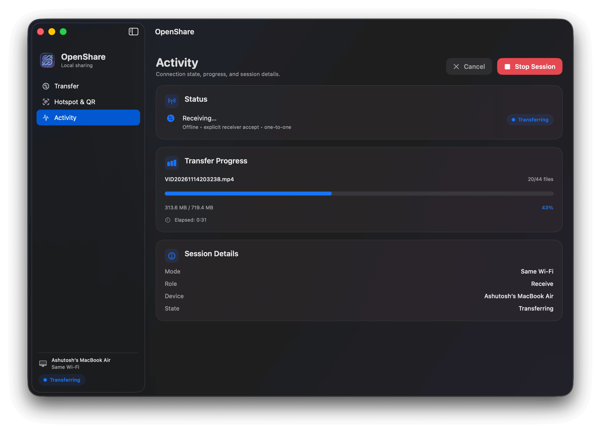 | 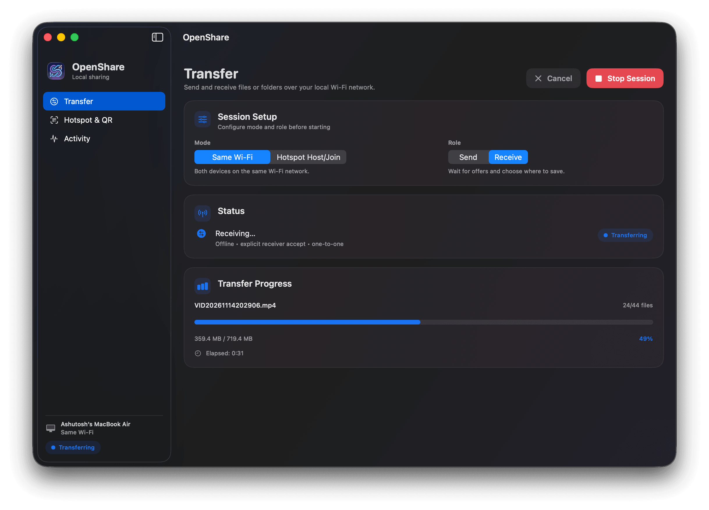 | 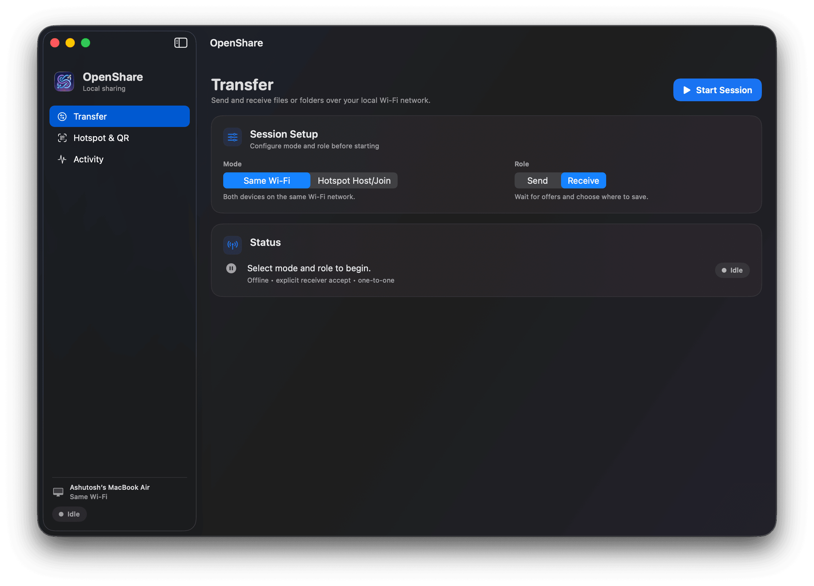 |
| 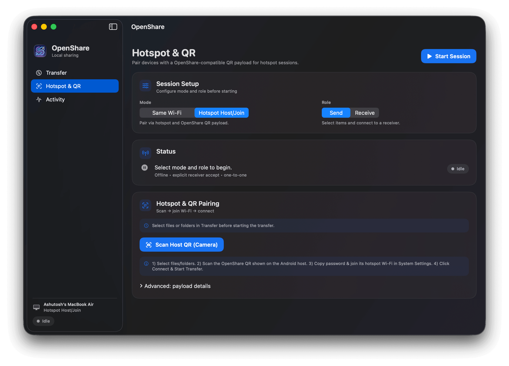 | 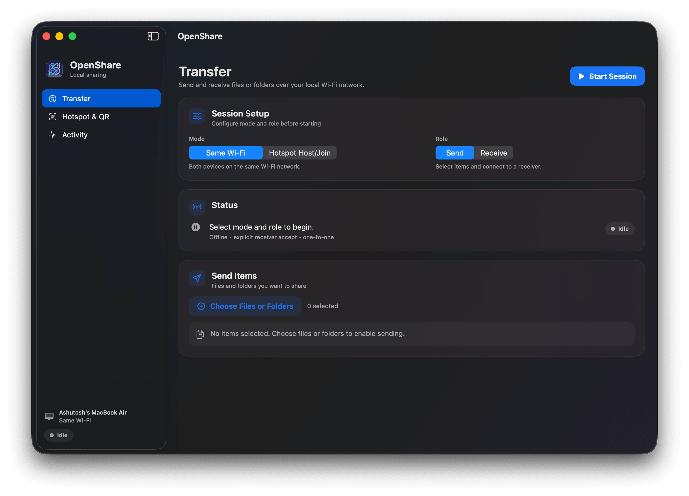 | 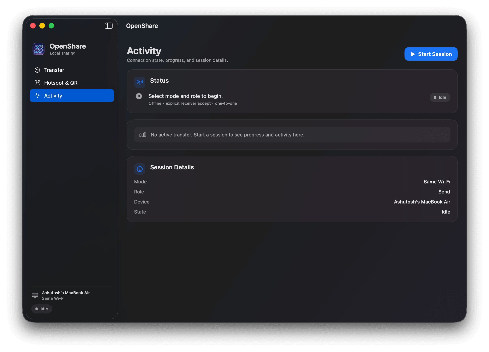 |

### Android

| | | |
| :---: | :---: | :---: |
| 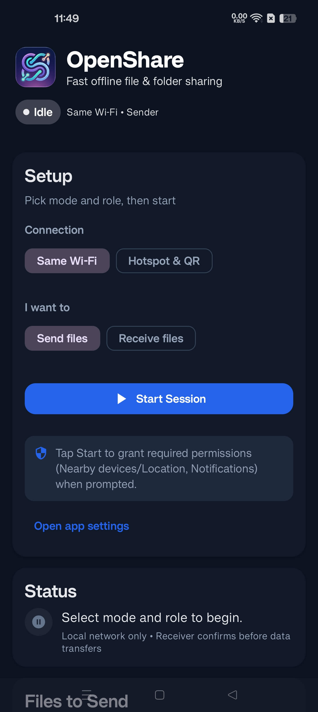 | 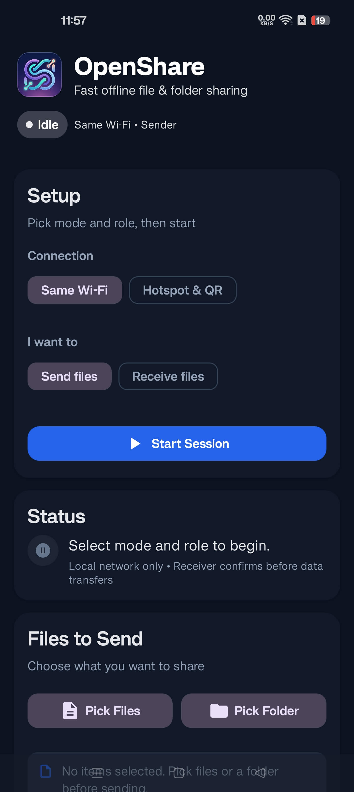 | 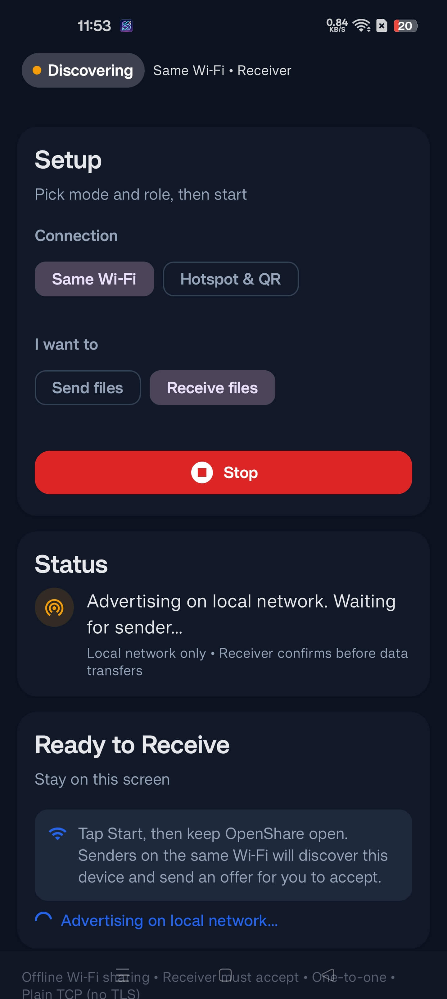 |
| 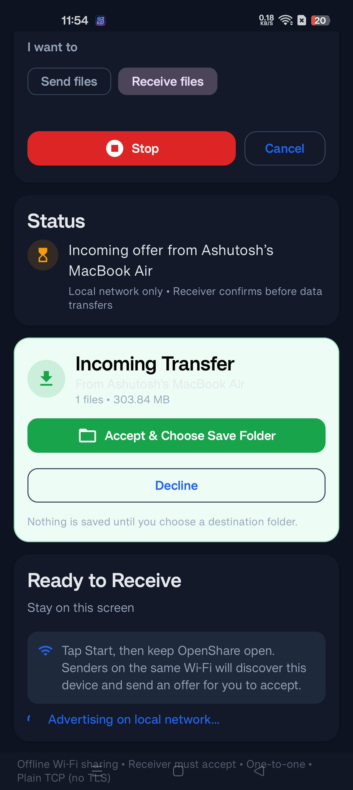 | 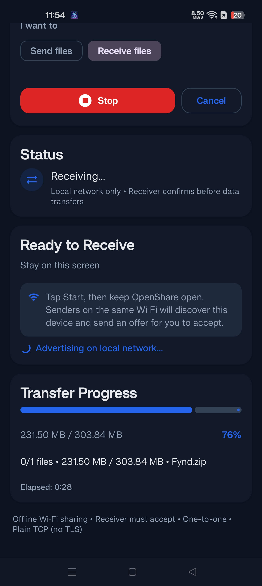 | 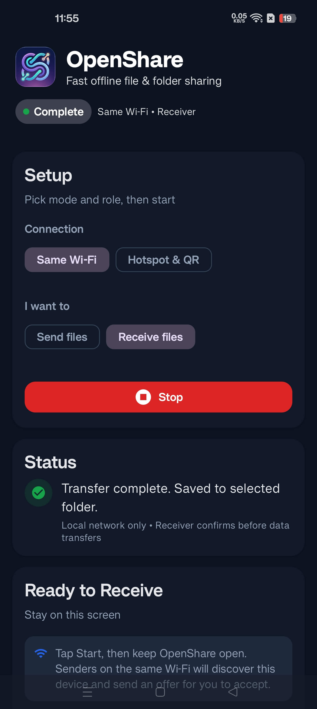 |

## Prebuilt Builds (Testing)

Unsigned/ad-hoc test artifacts are included in the [`build/`](build/) directory:

| Platform | Artifact | Notes |
| --- | --- | --- |
| macOS | [`OpenShare-macOS-mvp-unsigned.dmg`](build/macos/OpenShare-macOS-mvp-unsigned.dmg) | Contains `OpenShare.app` (ad-hoc signed, not notarized) |
| Android | [`OpenShare-android-debug.apk`](build/android/OpenShare-android-debug.apk) | Debug build for testing |
| Android | [`OpenShare-android-release-unsigned.apk`](build/android/OpenShare-android-release-unsigned.apk) | Release build, unsigned |

> **Note:** These builds are intended for development and testing.
> - **macOS:** If Gatekeeper blocks the app, allow it in **System Settings → Privacy & Security** or remove quarantine: `xattr -dr com.apple.quarantine <path-to-OpenShare.app>`
> - **Android:** Enable installation from unknown sources if prompted.
> - Distributable releases require proper macOS signing/notarization and Android release signing.

## Prerequisites

### Common
- Clone of this repository
- macOS and/or Android devices on the same local network, or able to join a host-created hotspot

### macOS
- macOS 13.0 or later
- Xcode Command Line Tools / Swift toolchain with SwiftPM (`swift --version`)
- Xcode recommended for signing, entitlements, and distributable `.app`/`.dmg` builds
- Camera permission (QR scanning) and Local Network permission (discovery/transfer)

### Android
- Android SDK (Platform & Build-Tools; project targets compileSdk 35)
- JDK compatible with AGP 8.5.x / Gradle 8.7 (JDK 17 recommended)
- Gradle wrapper included (`android/gradlew`)
- `ANDROID_HOME` set or `android/local.properties` configured with `sdk.dir`
- Android 8.0+ recommended for hotspot host (Local Only Hotspot) support

## Build from Source

### macOS

Build the release binary:

```bash
cd macos/OpenShareMac
swift build -c release
```

Package the app and DMG (ad-hoc/unsigned, as scripted):

```bash
./scripts/package-macos-dmg.sh
```

**Outputs:** `build/macos/OpenShare.app`, `build/macos/OpenShare-macOS-mvp-unsigned.dmg`

- Distributable, signed/notarized `.dmg` builds require an Xcode app target, entitlements, and Apple Developer credentials.
- See [`macos/README.md`](macos/README.md) and [`scripts/package-macos-dmg.sh`](scripts/package-macos-dmg.sh).

### Android

```bash
cd android
ANDROID_HOME=/path/to/android/sdk ./gradlew assembleDebug assembleRelease
```

**Outputs:**
- `android/app/build/outputs/apk/debug/app-debug.apk`
- `android/app/build/outputs/apk/release/app-release-unsigned.apk`

- Release distribution requires signing configuration and a keystore.
- See [`android/README.md`](android/README.md) and [`scripts/build-android-apk.sh`](scripts/build-android-apk.sh).

## Project Structure

| Path | Description |
| --- | --- |
| [`macos/OpenShareMac/`](macos/OpenShareMac/) | SwiftPM macOS app and core (`OpenShareCore`, `OpenShareMac`) |
| [`android/`](android/) | Android Gradle/Compose app |
| [`docs/protocol.md`](docs/protocol.md) | Shared transfer protocol/spec (v1) |
| [`docs/architecture.md`](docs/architecture.md) | Component overview and platform notes |
| [`docs/IMPLEMENTATION_STATUS.md`](docs/IMPLEMENTATION_STATUS.md) | Implementation status and remaining work |
| [`docs/BUILD_AND_DELIVERABLES.md`](docs/BUILD_AND_DELIVERABLES.md) | Build and deliverables notes |
| [`shared/fixtures/`](shared/fixtures/) | Sample manifest fixtures |
| [`scripts/`](scripts/) | Packaging and build scripts |
| [`build/`](build/) | Prebuilt test artifacts (DMG/APKs) |

## Status

Core same-Wi‑Fi and hotspot pairing/transfer flows are implemented on both platforms, including receiver acceptance, chunked transfer with acknowledgements, integrity verification, and progress/timing UI. Real-world Mac↔Android interoperability and edge-case validation (network conditions, permissions, large transfers, and backgrounding) are ongoing.

For details, see [`docs/IMPLEMENTATION_STATUS.md`](docs/IMPLEMENTATION_STATUS.md).
